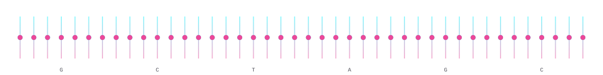

 

## `> whoami`

  

## `> ls ./projects`

<table>
  <tr>
    <td width="50%" valign="top">
      <h3>ꦕꦢꦱ꧀ &nbsp;CADAS App</h3>
      
Learn the Javanese language and <i>aksara Jawa</i> with help from AI. Daily streaks, level-based vocabulary, and audio for accurate dialect pronunciation.

      

        
        
        
      

      <a href="https://play.google.com/store/apps/details?id=com.cadas.app"><b>▸ Get it on Google Play</b></a>
    </td>
    <td width="50%" valign="top">
      <h3>🎬 &nbsp;Doomscrolling Effect</h3>
      
A 3-minute AI short film at 24 fps. Veo 3 keeps the shots temporally consistent, Sora 2 handles the complex camera changes.

      

        
        
        
        
        
      

      <a href="https://www.youtube.com/watch?v=xfoBW5Cxk3Y"><b>▸ Watch</b></a> &nbsp;·&nbsp; <a href="https://stopdoomscrolling.online"><b>▸ Website</b></a>
    </td>
  </tr>
  <tr>
    <td width="50%" valign="top">
      <h3>🕹️ &nbsp;Arcade Station</h3>
      
Browser games with a CRT look, all playable on my portfolio:

      <ul>
        <li><a href="https://ollyblu.vercel.app/codon"><b>CODON.EXE</b></a>: transcribe DNA to mRNA, then translate codons into real proteins like oxytocin and insulin. Watch out for silent, missense, and nonsense mutations.</li>
        <li><a href="https://ollyblu.vercel.app/serpent"><b>SERPENT.EXE</b></a>: cyberpunk snakes &amp; ladders</li>
        <li><a href="https://ollyblu.vercel.app/conway"><b>Game of Life</b></a>: Conway's cellular automaton, live</li>
        <li><a href="https://ollyblu.vercel.app/dinorun"><b>Neon Rex</b></a>: Dino Run remake with dash and double jump</li>
      </ul>
    </td>
    <td width="50%" valign="top">
      <h3>🔌 &nbsp;Arduino Superbox 102</h3>
      
A microcontroller box that combines home security with everyday automation. It started as a way to fill the COVID-19 lockdown and became the first of many hardware builds.

      

        
        
      

      <a href="https://www.instagram.com/p/C5ABOtnK03D/"><b>▸ See the build</b></a>
    </td>
  </tr>
</table>

## `> cat achievements.log`

| Year | Competition | Result | Notes |
| :--: | :-- | :-- | :-- |
| 2025 | **Virtual Trading Competition** | 🥇 1st Place | Indonesia Stock Exchange (IDX) |
| 2025 | **Kreasi AI TANOS** | 🏆 Best Work | Direktorat SMA, for *Doomscrolling Effect* |
| 2025 | **YR2E** | 🥈 2nd Place, Apps & Games | Yogyakarta Research Entrepreneurship & Exhibition, for *CADAS* |
| 2025 | **OSN Kecerdasan Artifisial** | 🎯 Top 30 Finalist | National Science Olympiad (AI), TOKI & Puspresnas |
| 2024 | **OSN Informatika** | 🏅 5th Place | Regency level |

## `> stack --list`

  

## `> git log --stats`

  
  
   
  

## `> ./snake.exe`

  <picture>
    <source media="(prefers-color-scheme: dark)" srcset="https://raw.githubusercontent.com/ollyblu/ollyblu/output/github-snake-dark.svg" />
    <source media="(prefers-color-scheme: light)" srcset="https://raw.githubusercontent.com/ollyblu/ollyblu/output/github-snake.svg" />
    
  </picture>

<code>$ cat fun_facts.txt</code>

 

- My [portfolio](https://ollyblu.vercel.app) runs like an old CRT terminal: matrix rain, glitch text, click sounds, and keys <kbd>1</kbd> to <kbd>4</kbd> for navigation.
- The matrix rain mixes katakana with *aksara Jawa* (ꦕꦢꦱ꧀).
- There is a cheat code hidden on the site. Try <kbd>↑</kbd><kbd>↑</kbd><kbd>↓</kbd><kbd>↓</kbd><kbd>←</kbd><kbd>→</kbd><kbd>←</kbd><kbd>→</kbd><kbd>B</kbd><kbd>A</kbd>.

 

> *"Melestarikan budaya bukan berarti terjebak di masa lalu, tapi membawa masa lalu ke masa depan dengan teknologi."*

